# AVA Steel Ring

A one-on-one fighting game in C# on .NET 10 and Avalonia 12. Four fighters, each with their own build, three
special moves and a super, fight best-of-three rounds against the clock. Play the one-player ladder against the
computer, or a friend at the same keyboard.

## Features

- **Four original fighters**:
  - **Kai** from Osaka is balanced, with a fireball, a rising fist and a whirling kick.
  - **Bruna** from São Paulo is heavy, with short reach, hard hits, a charge, an overhead hammer and a low stomp.
  - **Zen** from Taipei is the lightest and fastest, and fights with kicks and a sliding shadow step.
  - **Orla** from Galway has long reach and keeps you out with sparks, high and low.
- **Special moves from stick motions**:
  - A quarter circle forward or back.
  - Forward, down, down-forward for the rising moves.
  - Two quarter circles for the super.

  The game reads them from the last half-second of the stick, relative to the way you face.
- **Proper fighting rules**:
  - Hold back to block; crouch to block low attacks, stand for overheads.
  - Specials chip through a block.
  - Hit stun and block stun, pushback, knockdowns, and wake-up.
  - Normal moves that connect can be cancelled into a special for a combo.
  - Hits in a row are counted, each worth a little less.
  - One fireball at a time; two meeting cancel out.
- **A super meter** that fills as you hit and get hit, and carries from round to round. A full meter unleashes a
  super: the screen darkens, and it hits several times.
- **Rounds**: best of three, 60 seconds each. Time up goes to the healthier fighter, with a final round if needed.
- **One player** climbs a ladder of the other three fighters, and then meets their own shadow. The computer
  opponent grows harder with each bout, from a starting level of easy, normal or hard.
  - The computer reacts after a person's reaction time and puts its specials in as stick motions.
  - It blocks, anti-airs, jumps fireballs and combos.
  - Scoring: points for damage, the round, health and time left, a **perfect**, and the bout.
- **Two players** at one keyboard, or on two gamepads.
- **Five stages**: a neon street at night, a sunset beach, a mountain temple, sea cliffs in the drizzle, and the
  steel ring itself. Each has its own crowd.
- **Top-ten high-score table** with arcade-style initials entry, and **a demonstration** of two computer fighters
  after the title has been left alone.
- **Keyboard or gamepads**, **any window size** (the 4:3 screen scales to fit), and **Ctrl+S** for a screenshot.
- **Synthesised sound**: swishes, hits and blocks, fireballs, the super, the bell, the KO, a fight loop and a
  title tune.

## Screenshots

| Title | Choosing | Before the bout |
|:-----:|:--------:|:---------------:|
| 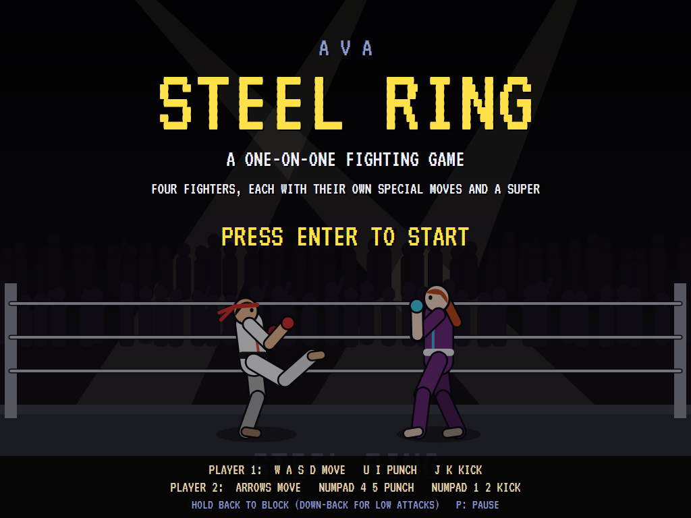 | 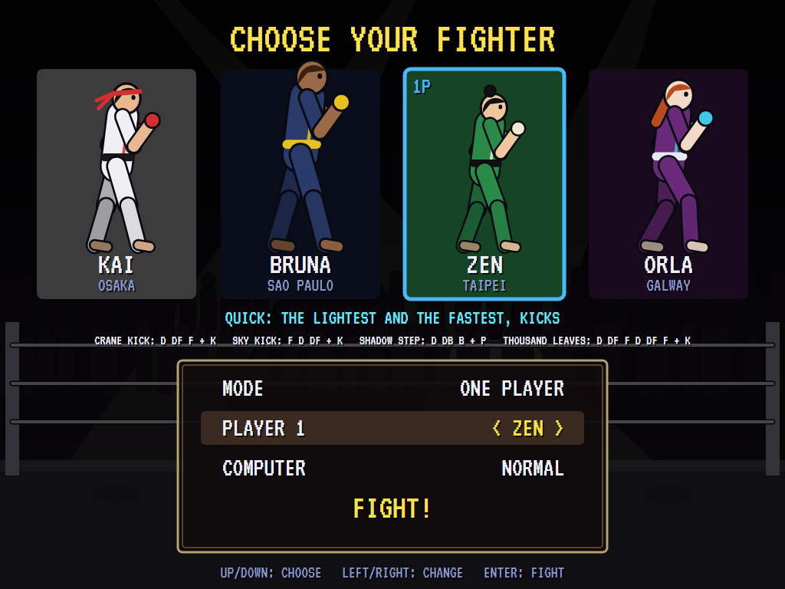 | 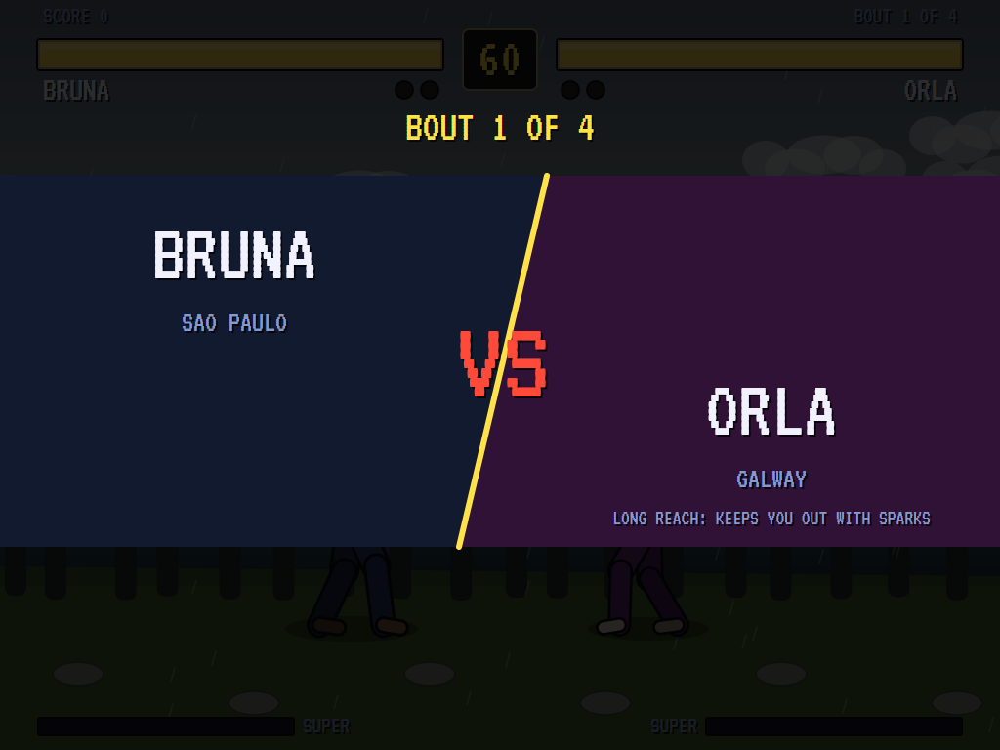 |
| Sparring under the title. | The roster, the mode, the computer's strength. | Face to face. |

| A hit | A fireball | The super |
|:-----:|:----------:|:---------:|
| 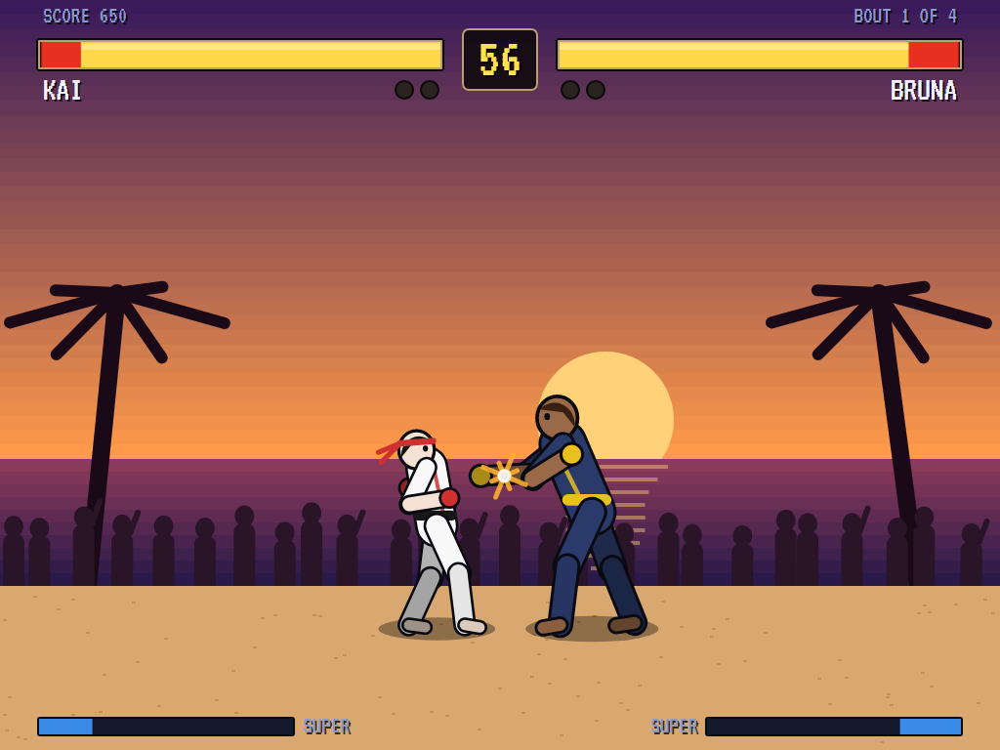 | 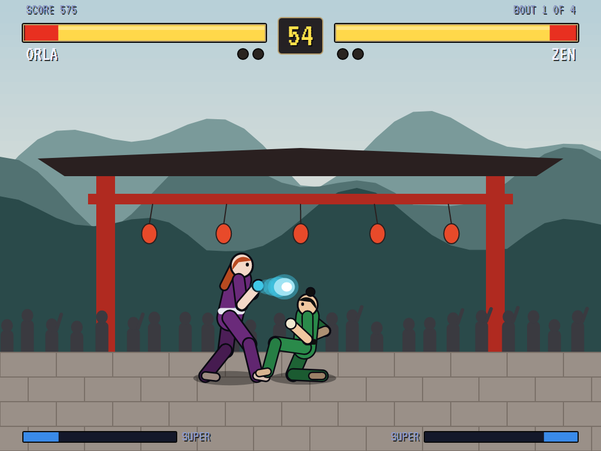 | 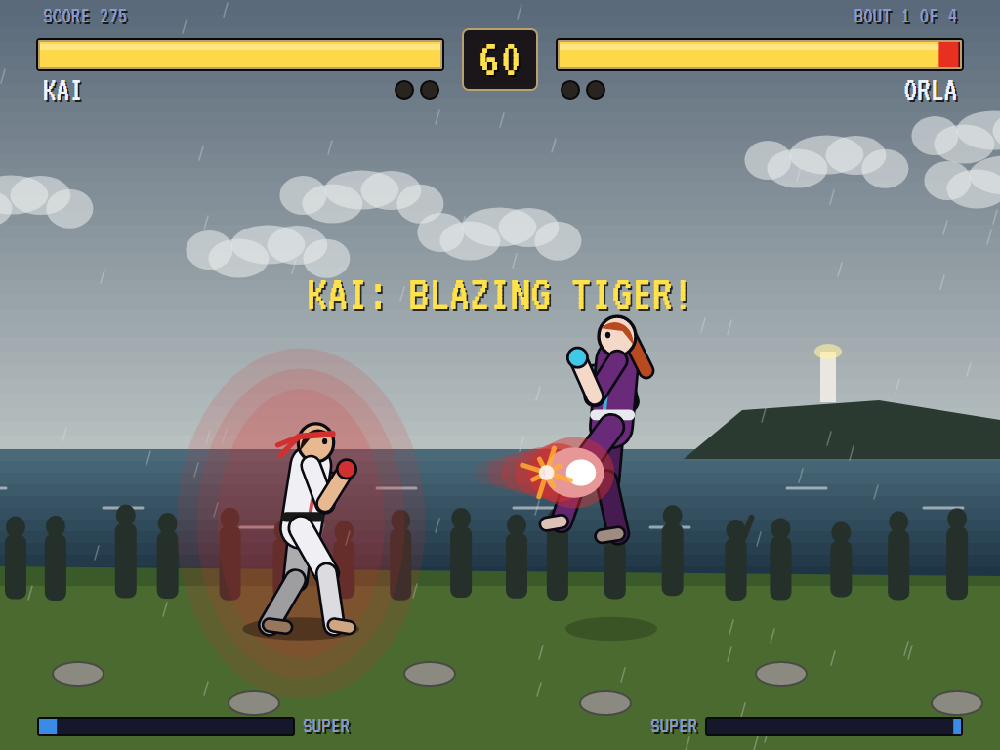 |
| On the beach at sunset. | Orla's spark at the temple. | Kai's Blazing Tiger on the cliffs. |

| K.O. | The round | High scores |
|:----:|:---------:|:-----------:|
| 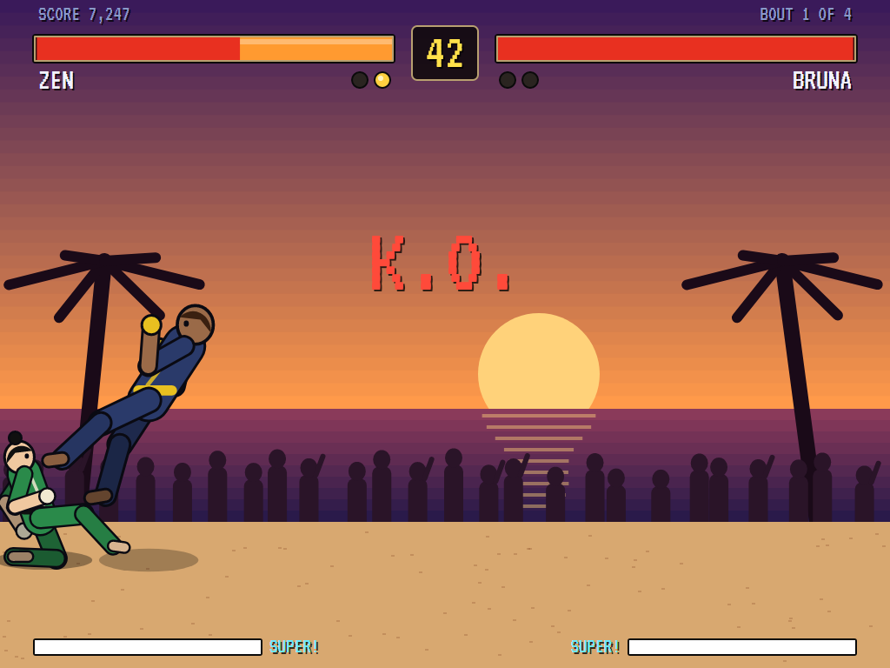 | 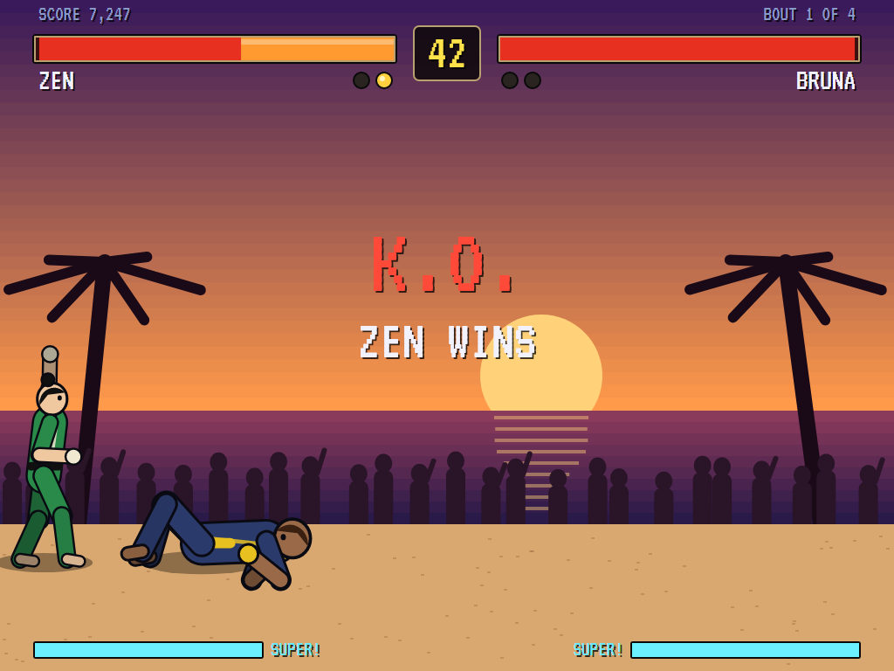 | 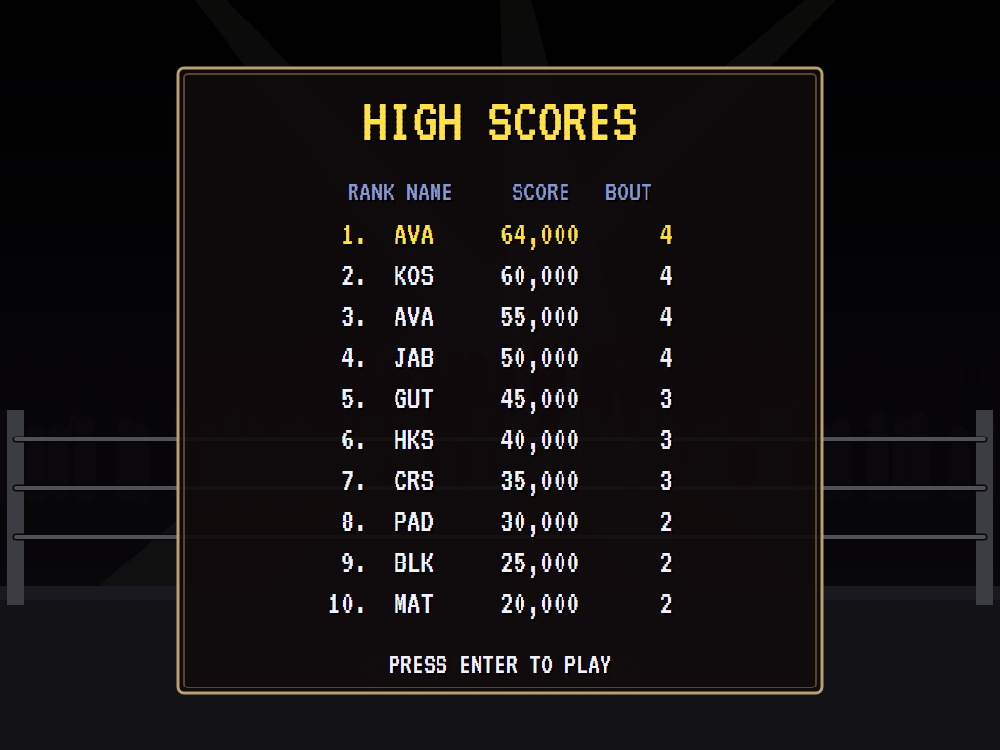 |
| Down and out. | The winner's pose. | The top ten. |

| The street | The ring |
|:----------:|:--------:|
| 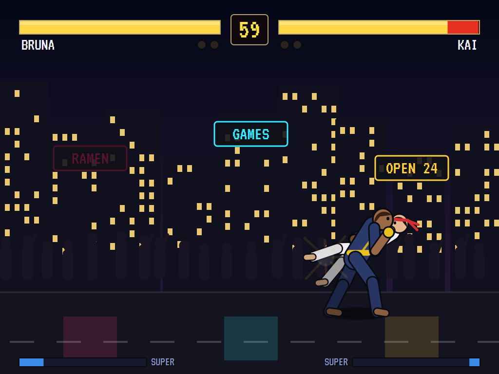 | 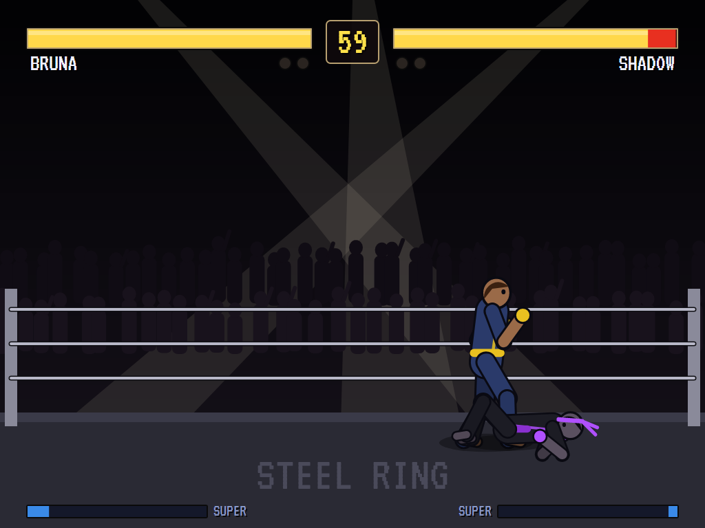 |
| Neon at night. | Where the shadow waits. |

## Download and run

Ready-to-run builds for Windows, macOS and Linux, on both Intel/AMD and ARM, are on the
[Releases page](https://github.com/Harlock123/AVASteelRing/releases/tag/latest). **Latest build** is
rebuilt on every push to `main`. Each download is one self-contained executable: no .NET install is
needed.

| Platform | Archive |
|---|---|
| Windows | `AVASteelRing-win-x64.zip`, `AVASteelRing-win-x86.zip`, `AVASteelRing-win-arm64.zip` |
| macOS | `AVASteelRing-osx-arm64.tar.gz` (Apple silicon), `AVASteelRing-osx-x64.tar.gz` (Intel) |
| Linux | `AVASteelRing-linux-x64.tar.gz`, `AVASteelRing-linux-arm64.tar.gz`, `AVASteelRing-linux-arm.tar.gz` |

```bash
tar -xzf AVASteelRing-linux-x64.tar.gz     # or linux-arm64, linux-arm, osx-arm64, osx-x64
./AVASteelRing
```

On Windows, unzip and run `AVASteelRing.exe`. On macOS, if Gatekeeper refuses to open it, run
`xattr -d com.apple.quarantine AVASteelRing` once. Run with `--no-audio` for silence.

**Sound** comes through OpenAL Soft, built in for every platform. In a virtual machine the game
detects it and uses a larger audio buffer, so the sound doesn't break up.

**Gamepads** use SDL2, which is bundled for Windows, macOS and Intel/AMD Linux. ARM Linux builds need it
installed; without it the keyboard still works:

```bash
sudo apt install libsdl2-dev            # Debian / Ubuntu / Raspberry Pi OS
sudo pacman -S --needed sdl2-compat     # Arch / Omarchy
```

## Controls

| Action | Player 1 keys | Player 2 keys | Gamepad |
|---|---|---|---|
| Move, jump, crouch | W A S D | Arrows | Stick or D-pad |
| Light punch, heavy punch | U, I | NumPad 4, 5 (or Insert, Home) | X, Y |
| Light kick, heavy kick | J, K | NumPad 1, 2 (or Delete, End) | A, B |
| Block | Hold back (down-back for low attacks) | | |
| Start | Enter or Space | | Start |
| Pause | P or Esc | | Start |
| Sound on/off | M | | |
| Screenshot | Ctrl+S (to your Pictures folder) | | |

In a one-player game both sets of keys and both gamepads control your fighter. The first gamepad is player 1's
and the second is player 2's.

**Specials**, written for a fighter facing right (P is either punch, K either kick):

| Fighter | Quarter forward (D DF F) | Forward, down, down-forward (F D DF) | Quarter back (D DB B) | Super (D DF F D DF F) |
|---|---|---|---|---|
| Kai | Tiger Flame (P): fireball | Rising Fist (P) | Whirl Kick (K) | Blazing Tiger (P) |
| Bruna | Bull Rush (P): charge | Hammer (P): overhead | Stomp (K): low | Avalanche (P) |
| Zen | Crane Kick (K) | Sky Kick (K) | Shadow Step (P) | Thousand Leaves (K) |
| Orla | Spark (P), Low Spark (K) | Arc Flash (P) | | Storm Wall (P) |

On the select screen, up and down choose a line and left and right change it; Enter starts the fight. On the
high-score table, type your initials, or use up/down and Space, then Enter.

## Tests

`dotnet test` runs them all headless. The gameplay tests check the following:

- Through the real key handler: that up jumps and down crouches, and that a quarter circle throws a fireball.
- That walking in before a quarter circle doesn't turn it into the rising move, and that the rising move rises.
- Hits and misses by reach, blocking at the right height, and chip damage.
- One fireball at a time, and two cancelling.
- A low kick cancelled into a special, the super needing a full meter, and knockdowns.
- Pushing apart and the walls, KOs and time up.
- Winning a bout and moving up the ladder, and losing and the high scores.
- That the computer fights a whole bout against itself without sticking, the select screen, the shadow at the
  top of the ladder, and the computer getting harder.

The screenshot tests draw the README's pictures (`RING_SHOTS=$PWD/Images dotnet test
tests/AVASteelRing.Tests --filter ScreenshotTests`).

## Building

```bash
dotnet build AVASteelRing.slnx
dotnet test AVASteelRing.slnx                 # headless: no window opens
dotnet run --project src/AVASteelRing
```

Needs the .NET 10 SDK. The sounds and music are made by `tools/make_sounds.py` (standard-library Python):
`python3 tools/make_sounds.py` rewrites `src/AVASteelRing/Sounds`.

## Project structure

```
AVASteelRing/
├── AVASteelRing.slnx
├── src/AVASteelRing/
│   ├── Engine/
│   │   ├── GameEngine.cs        # States, choosing, the ladder, bouts and rounds, scoring
│   │   ├── Fight.cs             # A round, frame by frame: moves, motions, hits, blocks, projectiles, the clock
│   │   ├── Moves.cs             # Moves and the roster of fighters
│   │   ├── Cpu.cs               # The computer at the controls
│   │   ├── HighScoreTable.cs, InitialsEntry.cs
│   │   ├── InputHandler.cs, ControllerManager.cs  # Two sets of keys and two SDL2 gamepads
│   │   └── SoundManager.cs      # Effects and music through OpenAL
│   ├── Audio/                   # The OpenAL engine (from the author's AVABand)
│   ├── Views/GameCanvas*.cs     # The fighters, the stages, the bars and the screens
│   └── Sounds/                  # The synthesised effects and tunes
├── tests/AVASteelRing.Tests/    # Gameplay and screenshot tests
├── tools/make_sounds.py
└── Images/                      # Screenshots
```

## About and licence

AVA Steel Ring © 2026 Lonnie Watson, under the [MIT License](LICENSE). An original game in the fighting genre; its
fighters, stages, graphics, sounds, music and code are its own. The VT323 font is © 2011 The VT323 Project Authors, under the SIL Open Font License (`src/AVASteelRing/Assets/Fonts/VT323-OFL.txt`).
